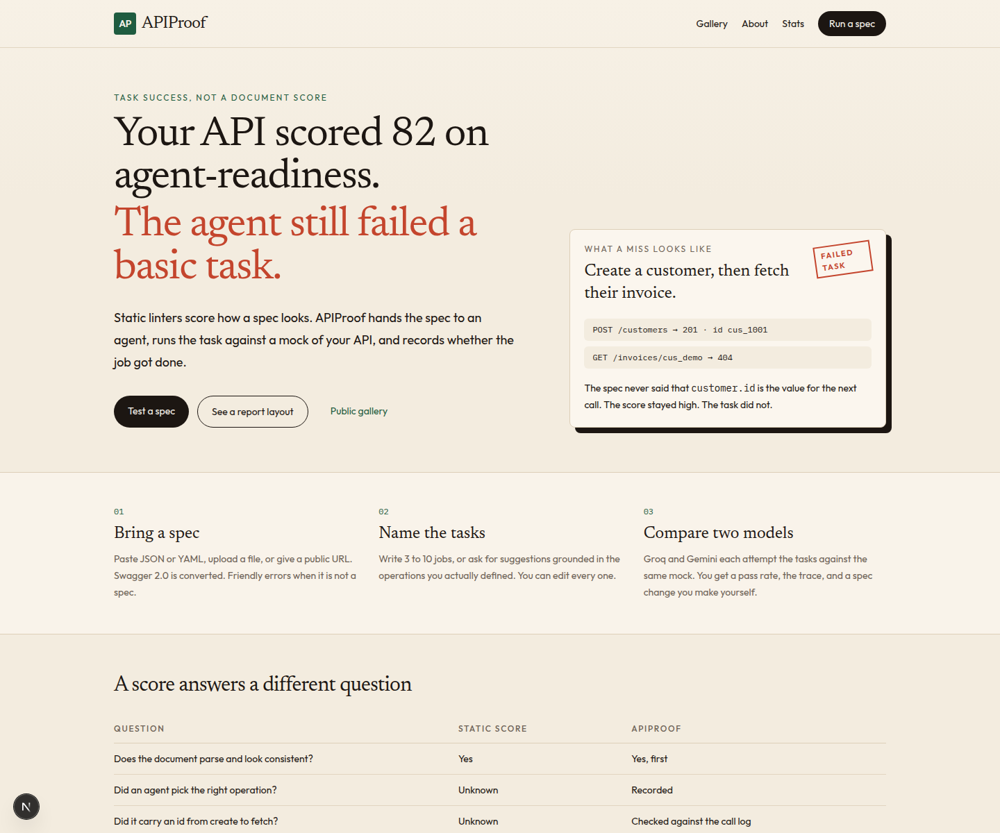
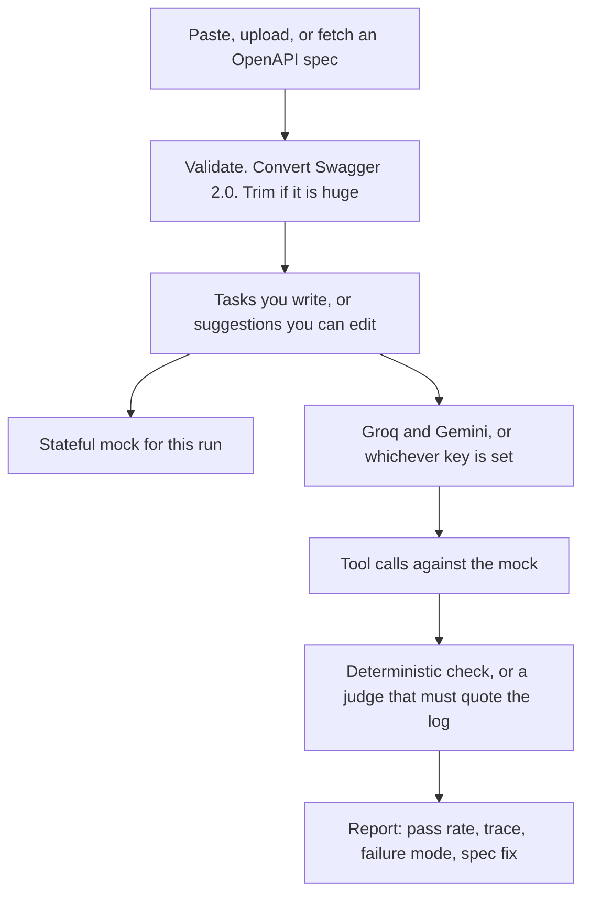

# APIProof

Your API scored 82 on agent-readiness. The agent still failed a basic task.

Static linters score how an OpenAPI document looks. APIProof measures whether an agent can finish a job. You give it a spec and a handful of tasks in plain language. It builds a stateful mock from the spec, hands the operations to a model as tools, and writes down what happened: pass or fail, the trace, and a spec change a person can make. It never calls the real API, and it never edits the spec.



The screenshot above is a capture of the local UI. A short GIF of a full run is still to be recorded before a public post.

## How a run works



1. The spec is parsed. OpenAPI 3.x is required. A document with `swagger: "2.0"` is converted. Private URLs are refused.
2. You add 3 to 10 tasks, or ask for suggestions. Suggestions from a model are editable. With no model key, suggestions come from the operations themselves.
3. For each task, each model gets the operations as tools. The mock keeps what POST creates, returns it from GET, and rejects a call that skips a required credential or a required field.
4. A confident task is graded from the call log: right operations, success statuses, literals from the sentence, and ids copied out of earlier responses. A vague task goes to a judge that has to cite a line from that log. A pass without a matching quote is thrown out.
5. The report is a link. Feedback is a yes or no, plus an optional comment.

Runs are chunked. The browser starts a run, then polls an advance endpoint that scores one pending task per model. That stays inside a Vercel Hobby function limit instead of holding one request open for the whole comparison.

## What was cut, on purpose

- No calls to third-party APIs. v1 is a mock.
- No accounts.
- No automatic spec edits. The suggestion names a method and a path. A human decides.
- Two providers. If one key is missing, the run says so and continues with the other. If both are missing in local development, a labeled stub agent previews the flow. That stub is not a measurement, and the gallery seed refuses to store it.
- Specs are capped (default 40 operations) so a run fits in context and in a short request.
- Webhooks and multi-step server jobs are out. The mock answers immediately.

Razorpay does not publish an official OpenAPI file at a stable URL. The gallery uses a small public community document for orders and payments, and the card says so. The other gallery specs are trimmed from official public documents: Petstore, GitHub REST, Stripe, OpenAI, Twilio, Spotify, DigitalOcean, and Slack.

## Metrics

`/stats` shows runs, unique specs, feedback responses, and the share marked useful. Live model runs are counted apart from stub previews. There is no user count in this repo. Do not add one until it is real.

Set `ADMIN_TOKEN` to require `?token=` on that page. Comments are stored and are not listed on the page.

## Local setup

```bash
npm install
cp .env.example .env.local
npm run dev
```

Open http://localhost:3000 and choose **Try Petstore**. Without `GROQ_API_KEY` and `GEMINI_API_KEY`, the run uses the stub agent and the report says so. With a key, the same button calls that provider.

Without `DATABASE_URL`, runs live in memory for the life of the dev server. Set the Neon URL when you want links to survive a restart.

```bash
npm run lint
npm run typecheck
npm test
npm run build
```

`npm test` includes the mock, the parser, the success checks, and one end-to-end Petstore run with a scripted model. It does not call Groq or Gemini.

## Free deploy

1. Create a project on [Neon](https://neon.tech) (free). Copy the pooled connection string. That is `DATABASE_URL`.
2. Create an API key at [console.groq.com](https://console.groq.com). That is `GROQ_API_KEY`. The default model is `openai/gpt-oss-120b`, falling back to `openai/gpt-oss-20b` after repeated 429s.
3. Create an API key at [aistudio.google.com/apikey](https://aistudio.google.com/apikey). That is `GEMINI_API_KEY`. The default model is `gemini-3.5-flash-lite`, falling back to `gemini-3.8-flash`. `gemini-2.0-flash` is retired and `gemini-2.5-flash` is deprecated. Flash-Lite thinks at `MINIMAL`. Gemini 3.8 Flash defaults to `MEDIUM` and does not accept `MINIMAL`, so APIProof sends `LOW` for it. That is what keeps a tool-calling task inside the 40 second budget. A 503 or a retired model id is retried, then the fallback model is tried. Each model call has its own `STEP_TIMEOUT_MS`, separate from the whole-task budget.
4. Import this repo in Vercel (Hobby is enough). Set the env vars from [.env.example](.env.example). Set `NEXT_PUBLIC_SITE_URL` to the deployed origin so Open Graph links resolve. Do not set `ALLOW_STUB_LLM`.
5. Deploy.
6. Run migrations against Neon from your machine:

   ```bash
   DATABASE_URL="postgres://…" npm run db:migrate
   ```

7. Seed the gallery from the deployed app. The server uses its own `DATABASE_URL`, `GROQ_API_KEY`, and `GEMINI_API_KEY`. `ADMIN_TOKEN` must be set. Each call scores one task per model, so a full gallery is many short requests instead of one long one. This spends real quota and writes real pass rates.

   ```bash
   session="$(date -u +%Y%m%dT%H%M%SZ)"
   while true; do
     body="$(curl -sf -X POST "$NEXT_PUBLIC_SITE_URL/api/admin/gallery/seed" \
       -H "authorization: Bearer $ADMIN_TOKEN" \
       -H "content-type: application/json" \
       -d "{\"session\":\"$session\"}")"
     echo "$body"
     echo "$body" | jq -e '.done == true' >/dev/null && break
   done
   ```

   `npm run gallery:seed` still works on a machine that has `DATABASE_URL` and a model key. It calls the same chunked function.

8. In the GitHub repo settings, add Actions secrets `APIPROOF_URL` (the deployed origin, no trailing path) and `ADMIN_TOKEN` (the same value as on Vercel). The workflow `.github/workflows/gallery.yml` re-runs the seed every Monday by calling the endpoint. It does not need database or model secrets. Until those two secrets exist, the workflow fails on purpose rather than inventing scores. The gallery page shows “Not run yet” until a seed finishes.

Refresh the vendored spec snapshots, without calling a model, with `npm run gallery:fetch`.

## Environment

| Name | Purpose |
| --- | --- |
| `DATABASE_URL` | Neon Postgres connection string |
| `GROQ_API_KEY` | Groq key. Optional only for a local stub preview |
| `GEMINI_API_KEY` | Gemini key. Same as above |
| `GROQ_MODEL` | Default `openai/gpt-oss-120b` |
| `GROQ_FALLBACK_MODEL` | Default `openai/gpt-oss-20b` |
| `GEMINI_MODEL` | Default `gemini-3.5-flash-lite` |
| `GEMINI_FALLBACK_MODEL` | Default `gemini-3.8-flash` |
| `GEMINI_THINKING_LEVEL` | Optional. Unset uses `MINIMAL` on Flash-Lite and `LOW` on Gemini 3.8 Flash |
| `STEP_TIMEOUT_MS` | Default 18000. One model call, including retry and fallback |
| `RATE_LIMIT_PER_IP_DAILY` | Default 8 new runs per IP per day |
| `RATE_LIMIT_GLOBAL_DAILY` | Default 200 new runs per day |
| `RATE_LIMIT_SALT` | Salt for the hashed IP |
| `MAX_SPEC_BYTES` | Default 1500000 |
| `MAX_OPERATIONS` | Default 40 |
| `MAX_AGENT_STEPS` | Default 6 tool rounds per task |
| `TASK_TIMEOUT_MS` | Default 40000. Checked between model calls, not as one abort for the whole task |
| `ADMIN_TOKEN` | Locks `/stats` when set, and is required for `POST /api/admin/gallery/seed` |
| `NEXT_PUBLIC_SITE_URL` | Public origin |
| `ALLOW_STUB_LLM` | Leave unset. `1` forces the stub even when keys exist |

A repeat of the same trimmed spec, tasks, and models returns the earlier report and does not count against the daily cap.

## License

MIT. Copyright 2026 Sachin Gautam.
